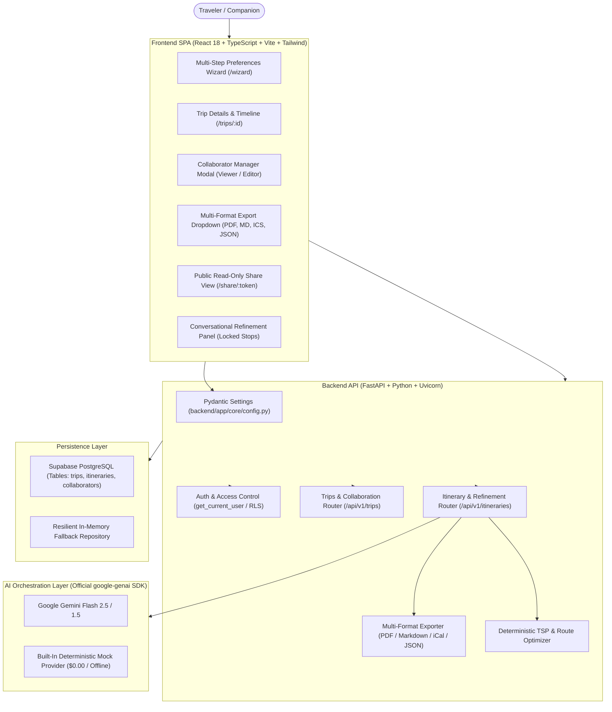

# WanderAI — AI-Powered Personalized Travel Itinerary Planner

[](https://fastapi.tiangolo.com)
[](https://python.org)
[](https://aistudio.google.com)
[](https://react.dev)
[](https://www.typescriptlang.org)
[](https://tailwindcss.com)
[](https://supabase.com)
[](https://pytest.org)
[](https://vitest.dev)
[](https://github.com)

A production-ready, security-hardened, and performance-optimized AI Travel Planner. Generates personalized, day-by-day itineraries calibrated to travel style, budget, pace, dietary preferences, accessibility, and interests with interactive route optimization, conversational refinement, activity locking, multi-format exports, and companion collaboration.

> **100% Free / Zero-Cost Stack**: Built using Google Gemini Flash (free tier: 15 RPM / 1M TPM), Supabase PostgreSQL (free tier: 500MB), Render & Vercel free hosting, and a built-in deterministic Mock provider for instant offline execution without external API keys.

---

## 1. Architecture Overview



---

## 2. Prerequisites

- **Python**: Version 3.10, 3.11, 3.12, or 3.13
- **Node.js**: Version 18, 20, or 22
- **npm**: Version 9+
- *(Optional)* **Docker & Docker Compose**: For containerized deployment

---

## 3. Environment Configuration & Secrets Management

The project uses strict environment variable separation. Secrets are never hardcoded, never exposed in client bundles, and never returned in API payloads or logs.

### Backend Environment Configuration

1. Copy `backend/.env.example` to `backend/.env`:
   ```bash
   cp backend/.env.example backend/.env
   ```

2. Generate a cryptographically secure random `SECRET_KEY`:
   ```bash
   cd backend
   python -c "import secrets; print(secrets.token_urlsafe(32))"
   ```
   Paste the generated string into `SECRET_KEY` in `backend/.env`.

3. **`backend/.env.example` Reference**:
   ```env
   APP_NAME=AI Travel Planner
   ENVIRONMENT=development
   DEBUG=false

   SECRET_KEY=your_generated_32_byte_token_here
   ACCESS_TOKEN_EXPIRE_MINUTES=30

   GEMINI_API_KEY=
   GEMINI_MODEL=gemini-2.5-flash

   SUPABASE_URL=
   SUPABASE_ANON_KEY=
   SUPABASE_SERVICE_ROLE_KEY=

   FRONTEND_URL=http://localhost:5173
   CORS_ORIGINS=http://localhost:5173

   API_HOST=127.0.0.1
   API_PORT=8000
   ```

### Obtaining a Google Gemini API Key (Free)
1. Navigate to [Google AI Studio](https://aistudio.google.com/apikey).
2. Sign in with your Google account.
3. Click **Create API Key**.
4. Set `GEMINI_API_KEY=AIzaSy...` in `backend/.env`.
5. Model is configurable via `GEMINI_MODEL=gemini-2.5-flash` (or `gemini-1.5-flash`).
6. *Offline / Zero-Cost Mode*: If `GEMINI_API_KEY` is omitted and `AI_PROVIDER=mock`, the application runs completely offline using the built-in deterministic provider.

### Supabase PostgreSQL Configuration (Free)
1. Create a free account at [supabase.com](https://supabase.com).
2. Create a new project and navigate to the **SQL Editor**.
3. Run the migrations in order:
   - `supabase/migrations/001_initial_schema.sql`
   - `supabase/migrations/002_itinerary_refinements_and_versioning.sql`
   - `supabase/migrations/003_trip_collaborators.sql`
4. Copy `SUPABASE_URL`, `SUPABASE_ANON_KEY`, and `SUPABASE_SERVICE_ROLE_KEY` into `backend/.env`.
5. *Offline Mode*: If Supabase credentials are not provided, the backend automatically operates using the thread-safe in-memory store.

### Frontend Environment Configuration

1. Copy `frontend/.env.example` to `frontend/.env`:
   ```bash
   cp frontend/.env.example frontend/.env
   ```

2. **`frontend/.env.example` Content**:
   ```env
   VITE_API_BASE_URL=http://localhost:8000
   ```
   > **Security Rule**: Vite exposes `VITE_` variables to the client bundle. Never put Gemini API keys, Supabase service-role keys, or JWT secrets in frontend environment files.

---

## 4. Installation & Local Development

### 1. Install Backend Dependencies
```bash
cd backend
python -m pip install --upgrade pip
pip install -r requirements.txt
```

### 2. Install Frontend Dependencies
```bash
cd frontend
npm install
```

### 3. Run the Development Servers

**Start Backend (Terminal 1)**:
```bash
cd backend
uvicorn app.main:app --host 127.0.0.1 --port 8000 --reload
```
- API Server: `http://localhost:8000`
- Interactive Swagger UI: `http://localhost:8000/docs`
- Health / Readiness Probes: `http://localhost:8000/health` & `http://localhost:8000/ready`

**Start Frontend (Terminal 2)**:
```bash
cd frontend
npm run dev
```
- Web Application: `http://localhost:5173`

---

## 5. Running Automated Test Suites

### Backend Tests (Pytest — 57 Tests)
```bash
cd backend
python -m pytest tests/ -v
```
**Test Coverage**:
- `test_secure_environment.py`: Environment validation, secret masking, Gemini config, CORS headers.
- `test_production_readiness.py`: Liveness/readiness probes, input validation boundaries, unauthorized access protection.
- `test_collaboration_and_export.py`: Collaborator CRUD (`viewer` vs `editor`) and multi-format exports (PDF, Markdown, iCalendar, JSON).
- `test_conversational_refinement.py`: Context preservation, locked activity retention, version snapshots.
- `test_database_layer.py`: Supabase PostgreSQL and fallback repository persistence.
- `test_gemini_provider.py`: Google Gen AI SDK integration and error mapping.
- `test_route_optimizer.py`: 2-opt TSP route permutation solver.

### AI Quality & Prompt Effectiveness Benchmark
```bash
cd backend
python tests/evaluate_ai_quality.py
```
Evaluates generated itineraries across diverse traveler personas (Solo Backpacker, Luxury Honeymoon, Family Accessible, Friends Nature, Weekend Sightseeing) and outputs `backend/evaluation_report.json` with a 95%+ quality benchmark score.

### Frontend Tests (Vitest & Testing Library — 11 Tests)
```bash
cd frontend
npm test -- --run
```
**Test Coverage**:
- `TripWizardValidation.test.tsx`: Destination validation, date range bounds, traveler limits, double-click submission guard.
- `TripDetailsComponents.test.tsx`: ActivityCard padlock lock/unlock, cost/time badges, edit/delete actions, Export menu options, Collaborator invite modal.
- `preferences.test.ts`: Zod travel preferences schema validation.

### Production Bundle Verification
```bash
cd frontend
npm run build
```
Builds code-split production bundles with `vendor-react` and `vendor-ui` chunks with 0 warnings.

---

## 6. Docker & Container Deployment

To launch the full production environment in containers:

```bash
# Build and run with Docker Compose
docker compose up --build
```
- Frontend: `http://localhost:3000`
- Backend: `http://localhost:8000`
- API Docs: `http://localhost:8000/docs`

---

## 7. Troubleshooting & FAQ

| Issue | Cause | Solution |
| :--- | :--- | :--- |
| `LLMAuthenticationError: Gemini API key is not configured` | `GEMINI_API_KEY` is missing in `backend/.env` while `AI_PROVIDER=gemini` | Set your key from [aistudio.google.com/apikey](https://aistudio.google.com/apikey) or set `AI_PROVIDER=mock` for offline mode. |
| `LLMQuotaExceededError: Gemini Flash rate limit` | Free tier quota (15 RPM) exceeded | Retry after 30 seconds or set `AI_PROVIDER=mock`. |
| `CORS Error in Browser` | Frontend domain not in `CORS_ORIGINS` | Add your frontend URL to `CORS_ORIGINS` in `backend/.env` (comma-separated). |
| `Database Connection Timeout` | Supabase paused or network block | The backend automatically falls back to the in-memory repository store without crashing. |
| `Vite Port Collision` | Port 5173 in use | Stop existing processes or run `npm run dev -- --port 5174`. |
