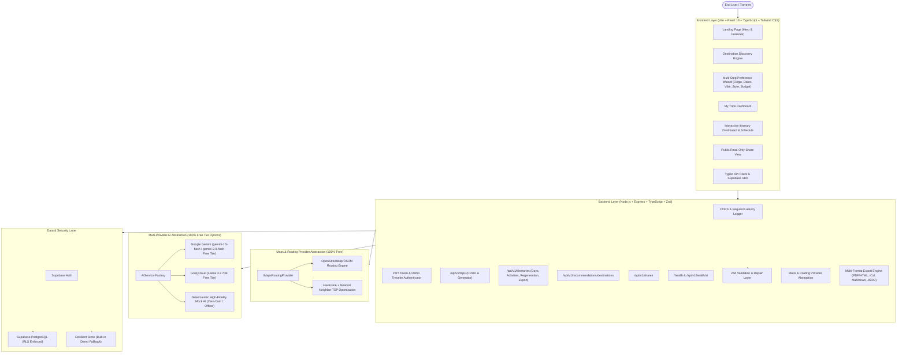

# Architecture & System Design: WanderAI Personalized Travel Planner

## 1. Executive Summary

WanderAI is a high-availability, full-stack AI travel planning web application built to eliminate planning fatigue. Unlike typical chatbot interfaces that output unstructured text itineraries with unrealistic travel schedules and geographic backtracking, WanderAI combines deterministic heuristic geographic routing with LLM structured inference to generate practical, evidence-grounded, day-by-day travel schedules with verifiable landmarks and realistic transit times.

---

## 2. Component Architecture

---

## 3. Technology Stack & Design Decisions

### Frontend
- **Framework**: React 18, TypeScript, Vite.
- **Styling**: Tailwind CSS with custom earthy sand/forest palette, responsive layouts, and accessible UI controls.
- **Icons & Animation**: Lucide React, Framer Motion.
- **Routing**: React Router v6.
- **Validation**: Zod for client-side preference validation.
- **Testing**: Vitest for frontend unit tests.

### Backend
- **Runtime & Framework**: Node.js v24, Express 4, TypeScript (strict mode enabled).
- **Validation**: Zod schema validation on all incoming request bodies, queries, URL parameters, and outgoing AI model responses.
- **Maps & Routing**:
  - `IMapsRoutingProvider` abstraction.
  - `OSRMProvider`: OpenStreetMap's free public OSRM routing service and Nominatim geocoder.
  - `HaversineProvider`: Mathematical great-circle distance with urban grid winding factor and Greedy Nearest Neighbor Traveling Salesperson (TSP) heuristic for activity ordering.
  - `RoutingService`: Seamless fallback ensuring offline reliability and zero API costs.
- **AI Recommendation Engine**:
  - `AIService` abstraction with timeout handling, markdown fence stripping, JSON parsing, and schema validation.
  - Supports Google Gemini free tier (`gemini-1.5-flash`), Groq free tier (`llama-3.3-70b-versatile`), and deterministic `MockAIProvider`.
- **Database & Security**:
  - Supabase PostgreSQL with Row Level Security (RLS) policies.
  - Foreign key constraints, cascading deletes, index optimization, and date range validity checks.
  - Built-in In-Memory Resilient Repository fallback so the MVP works instantly out-of-the-box without requiring database setup.
- **Export Formats**:
  - PDF-ready styled HTML dossiers.
  - Standard iCalendar (`.ics`) format for Google Calendar, Apple Calendar, and Outlook.
  - Structured Markdown notes.
  - Machine-readable JSON.

---

## 4. Deployment Topology

- **Frontend**: Prepared for **Render Static Site** (`render.yaml`).
- **Backend**: Prepared for **Vercel Serverless Function** (`api/index.ts`, `vercel.json`) and traditional Node.js containers.
