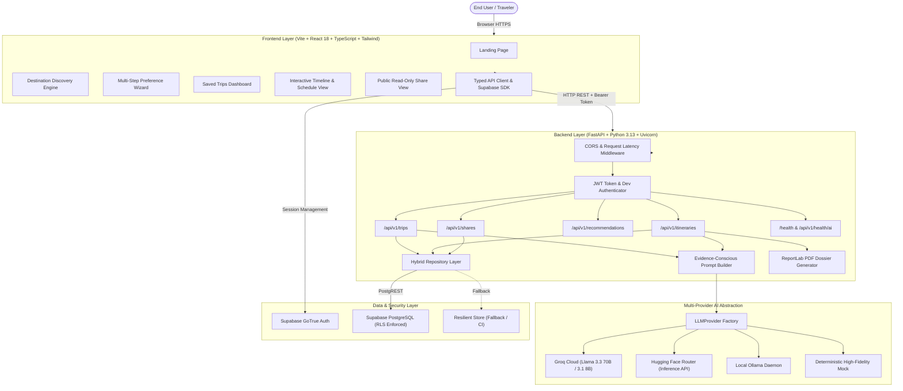

# Architecture & System Design: Personalized Travel Itinerary Planner

## 1. Executive Summary

WanderAI is a high-availability, full-stack travel SaaS application designed to eliminate planning fatigue. Unlike typical chatbot interfaces that output unstructured text itineraries with impossible back-to-back schedules and geographic backtracking, WanderAI combines deterministic heuristic scoring with LLM structured inference to generate practical, evidence-grounded, day-by-day travel schedules.

---

## 2. Component Architecture

---

## 3. Core Architectural Decisions

### 3.1 Multi-Provider AI Strategy
- The application implements the `LLMProvider` abstract base class defining `generate_structured()` and `check_health()`.
- **Groq API**: Primary hosted provider offering sub-second response times using JSON object mode.
- **Hugging Face**: Alternative hosted serverless endpoint with JSON-constrained prompts.
- **Ollama**: Local, offline-capable inference targeting local models like `llama3.2`.
- **Mock Provider**: Zero-cost, high-reliability provider for automated test suites and seamless demonstrations without requiring API keys.

### 3.2 Evidence-Conscious Prompting & Grounding
- Pacing calibrator assigns 2–3 stops/day for **Relaxed**, 3–4 for **Moderate**, and 4–5 for **Fast**.
- Hard constraints (dietary requirements, wheelchair accessibility) are strictly injected into prompts.
- Explicit verification tagging distinguishes well-known landmarks (`verified`) from approximate districts (`approximate`) and plausible suggestions (`estimated`).

### 3.3 Security & Zero-Trust Architecture
- All user-owned data is guarded by Row Level Security (RLS) in PostgreSQL.
- Authenticated endpoints derive identity directly from validated Bearer JWT tokens.
- Public sharing links rely on high-entropy 256-bit URL-safe tokens stored as SHA-256 hashes with revocation timestamps and optional expiration.
