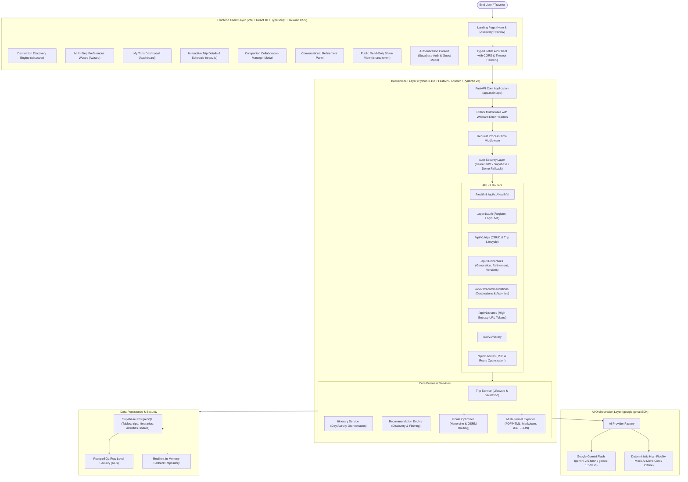
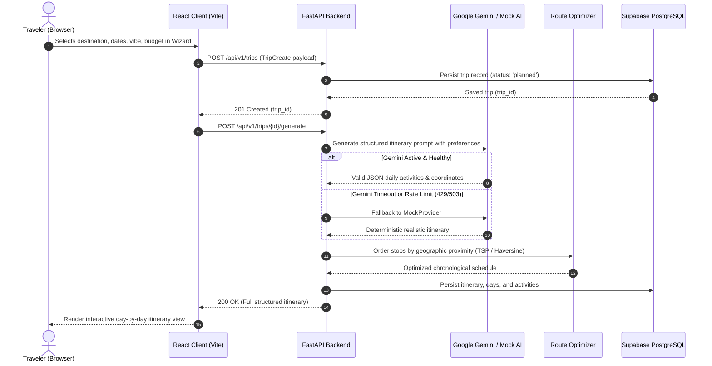

# Architecture & System Design: WanderAI Personalized Travel Planner

## 1. Executive Summary

WanderAI is a high-availability, full-stack AI travel planning web application designed to eliminate itinerary planning fatigue. Unlike generic chatbots that return wall-of-text itineraries with geographic backtracking and unrealistic travel schedules, WanderAI combines deterministic heuristic geographic routing with LLM structured inference to generate practical, evidence-grounded, day-by-day travel schedules with verifiable landmarks and realistic transit times.

---

## 2. System Architecture Diagram

---

## 3. Technology Stack & Key Decisions

### 3.1 Frontend Client Layer
- **Framework**: React 18 with TypeScript 5.5, bundled via Vite.
- **Styling**: Tailwind CSS with an earthy sand and forest-green color palette, responsive layout breakpoints, and dark text for readability.
- **UI & Animations**: Framer Motion for stepper transitions and Lucide React for consistent iconography.
- **Client Routing**: React Router v6 with lazy-loaded route chunking for minimal initial bundle size (< 120 kB gzip).
- **Client Validation**: Strong TypeScript interface contracts matching backend Pydantic schemas.
- **Testing**: Vitest + React Testing Library for component isolation and auth flow verification.

### 3.2 Backend Service Layer
- **Framework**: FastAPI (Python 3.11+), asynchronous request processing using Uvicorn ASGI.
- **Data Validation**: Pydantic v2 schemas for all request payloads, query parameters, and outgoing JSON responses.
- **Authentication**: Dual-mode auth supporting Supabase Bearer JWT tokens, local backend auth JWTs, and an explicit demo mode with zero friction.
- **Error Handling**: Unified global exception handling with automatic CORS header preservation on 4xx/5xx responses.
- **Testing**: Pytest with `httpx` async TestClient, 57 automated backend unit and integration tests.

### 3.3 AI Orchestration Layer
- **Primary Provider**: Google Gemini Flash (using the official `google-genai` SDK).
- **Model Sanitization**: Automatic stripping of surrounding quotes, whitespace, and legacy `models/` prefixes from environment configuration.
- **Structured JSON Output**: System prompts enforce strict JSON schema compliance. Markdown code fences are stripped before schema parsing.
- **Timeout & Fallback Protection**: 18-second timeout guard on live AI calls with automatic failover to the high-fidelity `MockProvider` to prevent user-facing hangs during upstream Gemini rate limits.

### 3.4 Data & Storage Layer
- **Primary Database**: Supabase PostgreSQL (free-tier 500 MB capacity) with Row Level Security (RLS) policies enforcing multi-tenant isolation.
- **Offline / Zero-Config Fallback**: Resilient In-Memory Repository allowing local testing and CI test suites to pass without live external database credentials.
- **Sharing Architecture**: Cryptographically secure URL-safe tokens (32 bytes entropy), hashed via SHA-256 before database storage to eliminate token enumeration attacks.

---

## 4. End-to-End Data Flow

---

## 5. Security Architecture

1. **Strict Secret Isolation**:
   - Environment secrets (`GEMINI_API_KEY`, `SUPABASE_SERVICE_ROLE_KEY`, `SECRET_KEY`) are stored in server-side environment variables and never baked into client bundles.
   - Frontend only accesses public `VITE_SUPABASE_URL` and `VITE_SUPABASE_ANON_KEY`.

2. **Row Level Security (RLS)**:
   - All trips, itineraries, activities, and collaborator tables enforce PostgreSQL RLS policies ensuring users can only read and mutate records they own or have been explicitly granted collaborator permissions on.

3. **Safe Public Sharing**:
   - Sharing links use `secrets.token_urlsafe(32)`. Only the SHA-256 hash of the token is stored in the database.
   - Public share endpoints deliver a sanitized, read-only view of the itinerary that excludes traveler IDs, account emails, and sensitive user profile fields.

4. **Defensive CORS Configuration**:
   - Explicit whitelist origin parsing supporting local development (`http://localhost:5173`, `http://localhost:3000`), production Vercel domains (`https://*.vercel.app`), and Render backends (`https://*.onrender.com`).
   - Exception handlers explicitly attach CORS response headers so cross-origin browsers receive clean JSON errors rather than opaque `TypeError: Failed to fetch`.
