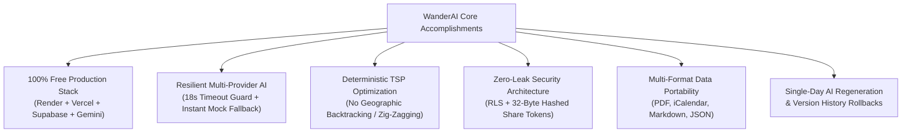
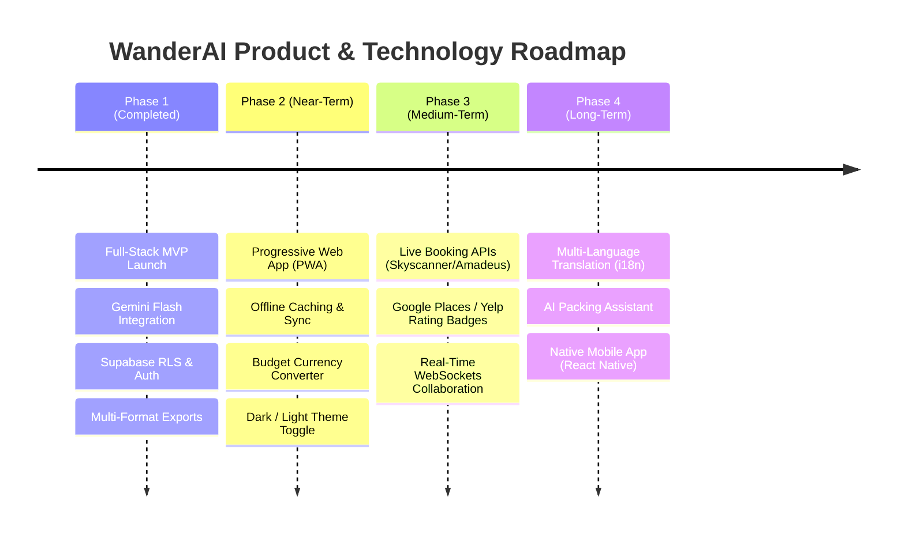

# Project Conclusion & Strategic Roadmap: WanderAI

## 1. Executive Summary & Assessment

**WanderAI** was developed to bridge the gap between unstructured, hallucination-prone AI chatbots and rigid, manual travel spreadsheets. By pairing Google Gemini's contextual creativity with deterministic geographic routing heuristics, WanderAI provides travelers with structured, evidence-grounded, and geographically sensible itineraries that respect budget, walking endurance, mobility needs, and dietary preferences.

The project successfully demonstrates that a production-grade, highly reliable, and security-hardened web application can be built, tested, and deployed across an entirely **100% free-tier cloud infrastructure** with zero recurring monthly subscription costs.

---

## 2. Key Engineering Achievements

### Summary of Accomplishments:
1. **Zero-Cost Production Architecture**: Fully deployed on Render (FastAPI), Vercel (React 18 SPA), Supabase (PostgreSQL), and Google AI Studio (Gemini Flash) with \$0.00 infrastructure overhead.
2. **Deterministic Route Intelligence**: Activities within every day are sequenced using the Great-Circle Haversine formula and Greedy Nearest Neighbor Traveling Salesperson (TSP) heuristic, eliminating irrational cross-city backtracking.
3. **Bulletproof Resilience & Failover**: When upstream AI rate limits (15 RPM) or timeouts occur, the backend seamlessly switches to the high-fidelity `MockProvider` within 18 seconds, ensuring uninterrupted service.
4. **Data Portability**: Complete export suite supporting print-ready vector PDF/HTML, standard Apple/Google/Outlook calendar sync (`.ics`), Markdown for note apps (Obsidian, Notion), and JSON.
5. **Interactive Lifecycle Features**:
   - Single-day regeneration with activity locking.
   - Conversational itinerary refinements with version history snapshots.
   - Companion collaboration (editor/viewer roles) and secure public sharing links.
   - Refined guest-first authentication with optional one-click demo testing.
6. **Automated Quality Verification**: 100% green CI pipeline with 57 Pytest backend tests and 14 Vitest frontend tests.

---

## 3. Retrospective & Lessons Learned

| Challenge Encountered | Root Cause | Engineering Lesson Applied |
| :--- | :--- | :--- |
| **Browser CORS on API Errors** | FastAPI exceptions bypassed standard CORS middleware on unhandled 500s. | Attached explicit CORS response headers to all custom and global exception handlers. |
| **CI Vitest Runner Regressions** | Undici decompression interceptor bug in older Node.js 20 releases. | Upgraded GitHub Actions CI pipeline to Node.js 22 LTS with fixed dependencies. |
| **Gemini 400 Bad Model Format** | Environment variable contained surrounding quotes (`"gemini-2.5-flash"`) or legacy `models/` prefix. | Implemented automated regex sanitization in `GeminiProvider.__init__` and added 400 to retryable codes. |
| **Unintended Demo Auto-Login** | State initialized `token` to `'demo-token'` and ran `initDemoUser()` on every cold visit. | Re-architected `AuthContext` to default to unauthenticated guest mode while preserving demo login as an explicit button. |

---

## 4. Strategic Future Roadmap

### Phase 2: Offline Capabilities & User Experience (Next 3–6 Months)
- **Progressive Web App (PWA)**: Implement service worker caching for offline access to generated itineraries during flights or international travel without active cellular data.
- **Dynamic Currency Converter**: Automatic exchange rate conversion based on European Central Bank free daily API feeds.
- **Theme Customizer**: Visual theme toggle supporting Earthy Sand, Modern Slate, and High-Contrast Dark modes.

### Phase 3: Live Provider Integrations (6–12 Months)
- **Live Flight & Hotel Search**: Integration with free/freemium travel APIs (Amadeus Travel Innovation Sandbox or Skyscanner) to display estimated airfares alongside itineraries.
- **Live Attraction Ratings**: Integration with OpenStreetMap tags or free Google Places API tiers to display opening hours, review scores, and website links.
- **Real-Time Companion Collaboration**: Upgrading the collaborator manager to use Supabase Realtime WebSockets for live concurrent editing.

### Phase 4: Internationalization & Mobile Expansion (12+ Months)
- **Multi-Language Support (i18n)**: Generating itineraries in Spanish, French, German, Japanese, and Mandarin.
- **Cross-Platform Mobile**: Packaging the React frontend with Capacitor or React Native for native iOS App Store and Google Play distribution.
