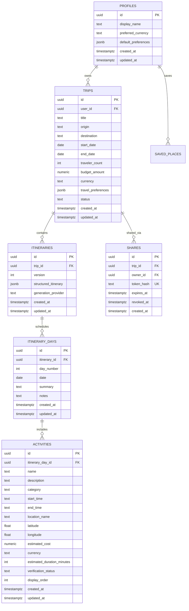

# Database Design & Migrations: Personalized Travel Itinerary Planner

## Overview
The application utilizes Supabase PostgreSQL with strict Row Level Security (RLS) enforcement.

---

## 1. Entity-Relationship Diagram

---

## 2. Row Level Security Policies Summary

| Table | Policy Name | Command | Rule |
| :--- | :--- | :--- | :--- |
| `profiles` | Users can view own profile | SELECT | `auth.uid() = id` |
| `profiles` | Users can update own profile | UPDATE | `auth.uid() = id` |
| `trips` | Users can manage own trips | ALL | `auth.uid() = user_id` |
| `trips` | Public read shared trip | SELECT | `EXISTS (SELECT 1 FROM shares WHERE shares.trip_id = trips.id AND revoked_at IS NULL AND (expires_at IS NULL OR expires_at > now()))` |
| `itineraries` | Users can manage own itineraries | ALL | `EXISTS (SELECT 1 FROM trips WHERE trips.id = itineraries.trip_id AND trips.user_id = auth.uid())` |
| `itinerary_days` | Users can manage own days | ALL | Owner of parent trip |
| `activities` | Users can manage own activities | ALL | Owner of parent trip |
| `shares` | Owners manage shares | ALL | `auth.uid() = owner_id` |
| `shares` | Public lookup by token hash | SELECT | `revoked_at IS NULL AND (expires_at IS NULL OR expires_at > now())` |

---

## 3. Applying Migrations to Supabase

1. Open your project at [Supabase Dashboard](https://supabase.com/dashboard).
2. Navigate to **SQL Editor**.
3. Copy the contents of `supabase/schema.sql` and click **Run**.
4. Confirm in **Table Editor** that `profiles`, `trips`, `itineraries`, `itinerary_days`, `activities`, `saved_places`, and `shares` are created with RLS enabled.
