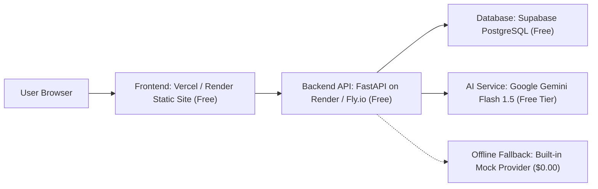

# Production Deployment & Hosting Guide (100% Free Tier)

This guide details how to deploy the **AI Travel Planner (WanderAI)** across completely free cloud infrastructure.

---

## 1. Zero-Cost Technology Architecture



| Component | Platform | Plan | Monthly Cost |
| :--- | :--- | :--- | :--- |
| **Frontend SPA** | Vercel or Render Static Site | Hobby / Free | **$0.00** |
| **Backend API** | Render Web Service or Fly.io | Free Tier | **$0.00** |
| **Database** | Supabase PostgreSQL | Free Tier (500MB, 2 active DBs) | **$0.00** |
| **AI LLM Engine**| Google Gemini Flash | Google AI Studio Free Tier (15 RPM) | **$0.00** |
| **Local Container**| Docker & Docker Compose | Community Open Source | **$0.00** |

---

## 2. Supabase PostgreSQL Setup (Free)

1. Create a free account at [supabase.com](https://supabase.com).
2. Create a new project (e.g. `wanderai-travel`).
3. In the **SQL Editor**, run the migration scripts in order:
   - `supabase/migrations/001_initial_schema.sql`
   - `supabase/migrations/002_itinerary_refinements_and_versioning.sql`
   - `supabase/migrations/003_trip_collaborators.sql`
4. Under **Project Settings** > **API**, copy:
   - Project URL (`SUPABASE_URL`)
   - `anon` `public` key (`SUPABASE_ANON_KEY`)
   - `service_role` `secret` key (`SUPABASE_SERVICE_ROLE_KEY`)

---

## 3. Backend Deployment to Render (FastAPI Web Service)

1. Push your repository to GitHub.
2. In the [Render Dashboard](https://dashboard.render.com), click **New** > **Web Service**.
3. Connect your repository.
4. Configure settings:
   - **Root Directory**: `backend`
   - **Environment**: `Python 3`
   - **Build Command**: `pip install -r requirements.txt`
   - **Start Command**: `uvicorn app.main:app --host 0.0.0.0 --port $PORT`
   - **Instance Type**: `Free`
5. Configure Environment Variables:
   ```bash
   APP_NAME=WanderAI Travel Planner
   APP_ENV=production
   AI_PROVIDER=gemini # or 'mock' for zero external API calls
   GEMINI_API_KEY=your_gemini_api_key_from_ai_studio
   SUPABASE_URL=https://your-project.supabase.co
   SUPABASE_ANON_KEY=your_anon_key
   SUPABASE_SERVICE_ROLE_KEY=your_service_role_key
   CORS_ORIGINS=https://your-frontend-domain.vercel.app,https://your-frontend-domain.onrender.com
   ```
6. Set **Health Check Path**: `/health` or `/ready`.
7. Click **Create Web Service**. Note your backend URL (e.g. `https://wanderai-api.onrender.com`).

---

## 4. Frontend Deployment to Vercel or Render (Static Site)

### Option A: Vercel (Recommended for instant Global CDN)
1. In [Vercel](https://vercel.com), click **Add New Project** and import the repository.
2. Set **Root Directory** to `frontend`.
3. Set **Framework Preset** to `Vite`.
4. Add Environment Variables:
   ```bash
   VITE_API_URL=https://wanderai-api.onrender.com
   VITE_SUPABASE_URL=https://your-project.supabase.co
   VITE_SUPABASE_ANON_KEY=your_anon_key
   ```
5. Click **Deploy**.

### Option B: Render Static Site
1. In Render, select **New** > **Static Site**.
2. **Root Directory**: `frontend`
3. **Build Command**: `npm install && npm run build`
4. **Publish Directory**: `dist`
5. Add Redirect / Rewrite Rule:
   - **Source**: `/*`
   - **Destination**: `/index.html`
   - **Action**: `Rewrite`

---

## 5. Single-Command Local Container Deployment

To launch the full production environment locally with Docker:

```bash
# 1. Clone repository
git clone https://github.com/your-username/personalized-travel-planner.git
cd personalized-travel-planner

# 2. Configure environment (optional, defaults to offline mock)
cp .env.example .env

# 3. Build and launch services
docker compose up --build
```

- **Frontend**: Accessible at `http://localhost:3000`
- **Backend Swagger Docs**: Accessible at `http://localhost:8000/docs`
- **Readiness Probe**: `http://localhost:8000/ready`
