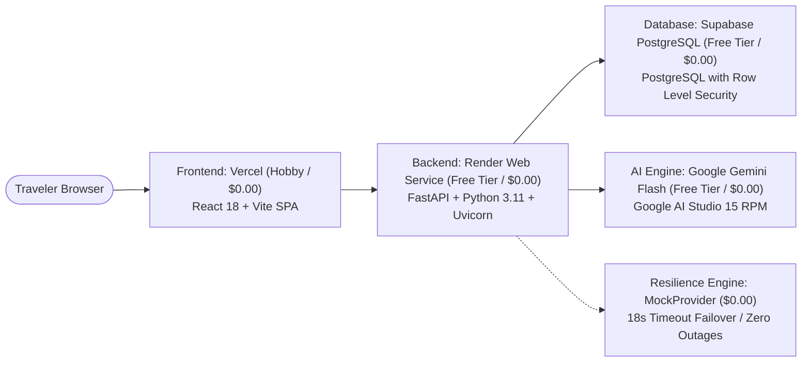

# Production Deployment & Hosting Guide (100% Free Tier)

This guide provides step-by-step instructions for deploying WanderAI across zero-cost, high-reliability cloud platforms using **Render** (FastAPI backend), **Vercel** (React SPA frontend), and **Supabase** (PostgreSQL).

---

## 1. Zero-Cost Production Architecture



### Cost Matrix
| Service | Role | Provider | Cost | Limits / Free Tier Allowance |
| :--- | :--- | :--- | :--- | :--- |
| **Frontend** | Static SPA Hosting | Vercel | **$0.00** | Unlimited bandwidth, global Edge CDN |
| **Backend** | REST API & AI Orchestration | Render | **$0.00** | 512 MB RAM, 0.1 CPU, spun down after 15 min inactivity |
| **Database** | Relational DB & Auth | Supabase | **$0.00** | 500 MB storage, 50,000 monthly active users |
| **AI LLM** | Recommendations & Daily Generation | Google AI Studio | **$0.00** | 15 Requests/Min, 1 Million Tokens/Min |
| **Total** | | | **$0.00/mo** | **100% Free** |

---

## 2. Backend Deployment on Render

### Step 1: Connect Your GitHub Repository
1. Log in to your [Render Dashboard](https://dashboard.render.com).
2. Click **New +** > **Web Service**.
3. Select your GitHub repository (`personalized-travel-planner`).

### Step 2: Configure Service Parameters
Configure the following fields:
- **Name**: `personalized-travel-planner` (or any custom service name)
- **Region**: Oregon (US West) or Frankfurt (EU Central)
- **Branch**: `main`
- **Root Directory**: `backend`
- **Runtime**: `Python 3`
- **Build Command**: `pip install -r requirements.txt`
- **Start Command**: `uvicorn app.main:app --host 0.0.0.0 --port $PORT`
- **Instance Type**: `Free`

### Step 3: Configure Backend Environment Variables
Under the **Environment Variables** tab, add:

| Key | Value / Instructions |
| :--- | :--- |
| `APP_NAME` | `WanderAI Travel Planner` |
| `ENVIRONMENT` | `production` |
| `SECRET_KEY` | High-entropy 32-byte secret string (can use a random JWT secret key). Generate using `python -c "import secrets; print(secrets.token_urlsafe(32))"`. |
| `AI_PROVIDER` | `gemini` (or `mock` for zero external API usage) |
| `GEMINI_MODEL` | `gemini-2.5-flash` |
| `GEMINI_API_KEY` | Your Google AI Studio API key (`AIzaSy...`) |
| `SUPABASE_URL` | `https://your-project.supabase.co` |
| `SUPABASE_ANON_KEY` | Public anon key from Supabase Project Settings |
| `SUPABASE_SERVICE_ROLE_KEY` | Secret service role key from Supabase Project Settings |
| `CORS_ORIGINS` | Comma-separated allowed origins (e.g., `https://*.vercel.app,http://localhost:5173`) |

> [!TIP]
> **What is `SECRET_KEY` and can I use my JWT secret?**
> Yes! `SECRET_KEY` is the symmetric secret used by the backend to sign and verify local JWT access tokens and cryptographically hash sessions. Any high-entropy random string (or your Supabase JWT secret) works perfectly.

### Step 4: Verify Deployment
Once deployed, verify the service by opening the root and health endpoints:
- `https://your-backend.onrender.com/` $\rightarrow$ Returns `{"message": "Welcome to WanderAI Travel Planner", ...}`
- `https://your-backend.onrender.com/health` $\rightarrow$ Returns `{"status": "healthy", ...}`

---

## 3. Frontend Deployment on Vercel

### Step 1: Import Project in Vercel
1. Log in to [Vercel](https://vercel.com).
2. Click **Add New...** > **Project**.
3. Import your GitHub repository (`personalized-travel-planner`).

### Step 2: Configure Build & Directory Settings
- **Framework Preset**: `Vite`
- **Root Directory**: Click *Edit* and select `frontend`.
- **Build Command**: `npm run build`
- **Output Directory**: `dist`
- **Install Command**: `npm install`

### Step 3: Configure Frontend Environment Variables
Add the following under **Environment Variables**:

| Variable | Value | Description |
| :--- | :--- | :--- |
| `VITE_API_URL` | `https://your-backend.onrender.com` | **Live Render Backend URL** (do NOT add a trailing slash) |
| `VITE_API_BASE_URL`| `https://your-backend.onrender.com` | Alias for API base URL |
| `VITE_SUPABASE_URL`| `https://your-project.supabase.co` | Supabase Project URL |
| `VITE_SUPABASE_ANON_KEY` | `eyJhbG...` | Supabase Public Anon Key |

> [!IMPORTANT]
> The `VITE_API_URL` variable **must** point to your Render backend URL (e.g. `https://personalized-travel-planner-9wvk.onrender.com`). Do not leave it pointing to `localhost`.

### Step 4: Deploy & SPA Route Rewrites
Click **Deploy**.
The `frontend/vercel.json` file in this repository ensures client-side routing works without 404s:
```json
{
  "rewrites": [
    {
      "source": "/(.*)",
      "destination": "/index.html"
    }
  ]
}
```

---

## 4. Supabase Database Deployment

1. Open your project on [supabase.com](https://supabase.com).
2. In the **SQL Editor**, run the migration scripts in numerical sequence:
   - `supabase/migrations/001_initial_schema.sql`
   - `supabase/migrations/002_itinerary_refinements_and_versioning.sql`
   - `supabase/migrations/003_trip_collaborators.sql`
3. Under **Authentication** > **Providers**, ensure **Email** is enabled.
4. Under **URL Configuration**, set the Site URL to your live Vercel URL (e.g. `https://your-app.vercel.app`) to ensure email redirect links work.

---

## 5. Free-Tier Operational Tips

### Handling Render Cold Starts
- On Render's free tier, backend instances spin down after 15 minutes of inactivity. The first request after sleep takes ~30–50 seconds to wake up.
- **Client Resilience**: The frontend API client automatically catches connection failures during cold starts and displays a clear message informing the user that the server is warming up.
- **Preventing Sleep (Optional)**: You can set up a free monitor on [UptimeRobot](https://uptimerobot.com) to ping `https://your-backend.onrender.com/health` every 10 minutes to keep the instance warm.
