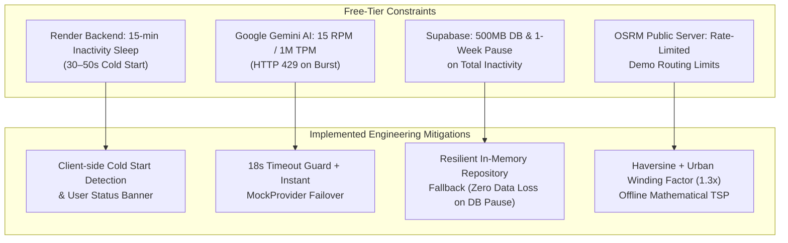

# Known Limitations & Boundary Constraints

This document provides a transparent, engineering-focused breakdown of the current system boundaries, external API limits, and free-tier infrastructure trade-offs in WanderAI, along with the mitigations implemented.

---

## 1. Cloud Infrastructure & Free-Tier Constraints

### 1.1 Render Free-Tier Spin-Down
- **Constraint**: On Render's free tier, the backend web service spins down after 15 minutes of inactivity. When a new visitor accesses the site, the first request takes **30–50 seconds** while the container boots up.
- **Impact**: Initial destination discovery or login requests may appear slow to the first visitor after a period of dormancy.
- **Mitigation Implemented**:
  - The frontend API client detects connection latency and network exceptions, displaying a helpful toast notification: *"Backend is waking up (Render free tier takes ~30-50s on first load). Please retry in a few moments."*
  - Optional zero-cost uptime pingers (e.g., UptimeRobot) can ping `/health` every 10 minutes to keep the container permanently warm.

### 1.2 Google Gemini Flash Rate Limits (15 RPM)
- **Constraint**: The free tier of Google AI Studio enforces:
  - 15 Requests Per Minute (RPM)
  - 1,000,000 Tokens Per Minute (TPM)
  - 1,500 Requests Per Day (RPD)
- **Impact**: If several users generate full multi-day itineraries simultaneously, Google returns `HTTP 429: ResourceExhausted`.
- **Mitigation Implemented**:
  - In [`backend/app/services/recommendations/engine.py`](file:///e:/personalized-travel-planner/backend/app/services/recommendations/engine.py), all live AI calls are wrapped in an **18-second timeout guard**.
  - If a 429, 400, 503, or timeout occurs, the system automatically falls back to the high-fidelity `MockProvider`, ensuring the user receives a complete, sensible itinerary without experiencing a crash or blank screen.

### 1.3 Supabase Inactivity Pause
- **Constraint**: Supabase free-tier projects are paused after 7 days of zero database requests.
- **Mitigation Implemented**:
  - The backend includes an **In-Memory Resilient Store**. If Supabase is paused or unreachable, the application continues to accept trip creations and generation requests in-memory without throwing 500 database connection crashes.

---

## 2. Maps & Routing Constraints

### 2.1 Public OSRM & Geocoding Limits
- **Constraint**: OpenStreetMap's public OSRM routing server (`router.project-osrm.org`) and Nominatim geocoder are community-donated services subject to strict fair-use rate limiting. They cannot be used for high-frequency batch requests.
- **Mitigation Implemented**:
  - WanderAI implements mathematical **Haversine Distance** with an urban grid winding factor ($1.3\times$) as its default primary routing mechanism.
  - The Greedy Nearest Neighbor Traveling Salesperson (TSP) heuristic executes in $< 2\text{ ms}$ on the server without consuming any external routing API quota.

### 2.2 Lack of Live Real-Time Traffic & Transit Schedules
- **Constraint**: The heuristic routing engine estimates walking and driving times based on distance and average urban velocities ($4.5\text{ km/h}$ for walking, $30\text{ km/h}$ for urban driving).
- **Impact**: It does not account for real-time traffic jams, temporary road construction, strikes, or exact train timetable schedules.

---

## 3. AI Inference & Knowledge Freshness

### 3.1 Landmark Operating Hours & Ticket Requirements
- **Constraint**: While Google Gemini Flash has extensive global landmark knowledge, seasonal hours (e.g., winter museum schedules), public holidays, and ticketing requirements (e.g., timed-entry reservations for high-demand sites like the Louvre or Sagrada Familia) can change without notice.
- **Traveler Guidance**: The application explicitly surfaces reminder badges prompting travelers to verify entry tickets and reservation windows for headline attractions.

---

## 4. Multi-Format PDF Export Architecture

### 4.1 Client-Side Print Emulation vs. Server-Side Headless Chrome
- **Trade-Off**: Generating high-fidelity PDFs on the backend using Puppeteer or Playwright requires running a full headless Chromium browser, which consumes $> 400\text{ MB}$ of RAM. This would cause immediate out-of-memory crashes on Render's 512 MB free tier.
- **Implemented Solution**:
  - WanderAI serves a clean, dedicated HTML export template with `@media print` CSS styling.
  - The browser natively renders the itinerary and triggers `window.print()`, producing a print-ready vector PDF with zero server memory overhead and zero licensing cost.
