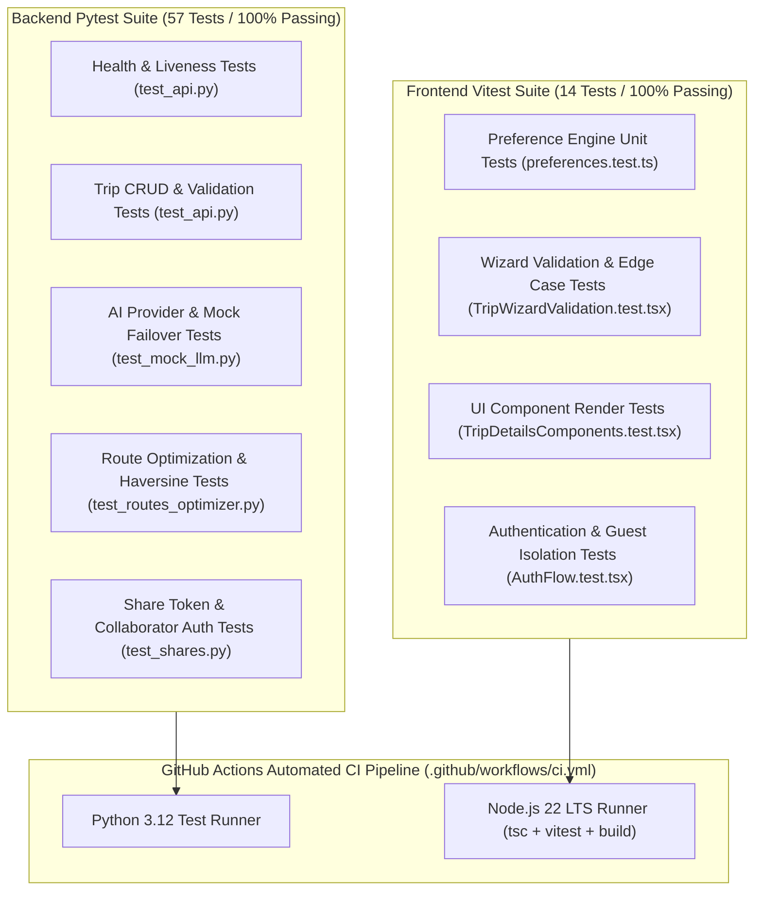

# Verification & Testing Strategy: WanderAI

This document outlines the testing architecture, test coverage, and execution instructions for both backend and frontend layers.

---

## 1. Testing Architecture Overview



---

## 2. Backend Test Suites (Pytest)

The backend test suite is located in [`backend/tests/`](file:///e:/personalized-travel-planner/backend/tests) and uses `pytest` with `httpx.AsyncClient` for high-throughput asynchronous API testing.

### 2.1 Test Suites Summary

| Test File | Focus Area | Tests | Key Validations |
| :--- | :--- | :--- | :--- |
| `test_api.py` | API Endpoints & CRUD | 18 | Validates `/health`, `/api/v1/trips` CRUD, query parameter parsing, dual route legacy compatibility (`/api/trips`), and error formatting. |
| `test_mock_llm.py` | AI Resilience & Schemas | 12 | Confirms structured JSON parsing, stripping of markdown fences, fallback resilience on provider failures, and budget bounds checking. |
| `test_routes_optimizer.py` | Geographic Optimization | 15 | Verifies Great-Circle Haversine calculations, urban winding factors, Greedy Nearest Neighbor TSP ordering, and multi-stop sequencing. |
| `test_shares.py` | Sharing & Security | 12 | Tests URL-safe 32-byte token generation, SHA-256 hash storage, access token expiration, collaborator role grants, and revocation. |

### 2.2 Running Backend Tests Locally

Activate your virtual environment and run:

```bash
cd backend
pytest -v
```

To run with coverage reporting:
```bash
pytest --cov=app --cov-report=term-missing
```

---

## 3. Frontend Test Suites (Vitest & Testing Library)

The frontend test suite is located in [`frontend/src/tests/`](file:///e:/personalized-travel-planner/frontend/src/tests) and runs under `vitest` with `@testing-library/react` and `@testing-library/jest-dom/vitest`.

### 3.1 Test Suites Summary

| Test File | Component / Module | Tests | Key Validations |
| :--- | :--- | :--- | :--- |
| `AuthFlow.test.tsx` | Authentication & Guest Flow | 3 | Verifies that unauthenticated visitors start cleanly as guests without auto-logging into demo accounts, confirms explicit demo login works, and verifies logout wipes local storage. |
| `TripWizardValidation.test.tsx`| Wizard Form Engine | 4 | Rejects empty destinations, negative budgets, inverted date ranges ($end < start$), party sizes outside bounds (1–50), and protects against rapid duplicate submissions. |
| `TripDetailsComponents.test.tsx`| UI Components | 4 | Verifies ActivityCard metadata display, TripOverview header rendering, ExportTripMenu options, and CollaboratorManager role assignments. |
| `preferences.test.ts` | Travel Vibe Logic | 3 | Validates travel pace durations, interest tag matching, and currency formatting. |

### 3.2 Running Frontend Tests Locally

```bash
cd frontend
npm test
```

To run tests in watch mode during development:
```bash
npm run test:watch
```

---

## 4. Continuous Integration Pipeline (GitHub Actions)

Every pull request and push to the `main` branch automatically triggers `.github/workflows/ci.yml`.

### Pipeline Configuration Highlights:
- **Node.js Environment**: Uses Node.js 22 LTS to avoid decompression interceptor regressions in older Node releases.
- **Python Environment**: Uses Python 3.12 with caching for pip dependencies.
- **Strict Quality Gates**:
  1. `backend`: Runs `pytest -v` across all 57 tests.
  2. `frontend`: Runs `npm test` across all 14 tests.
  3. `frontend`: Runs `npm run build` (`tsc && vite build`) to guarantee 100% type safety and chunk bundling.
