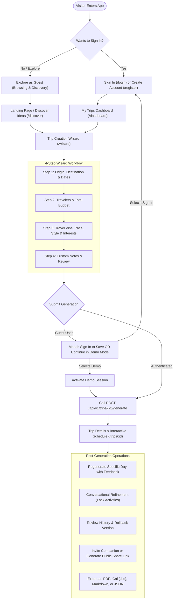
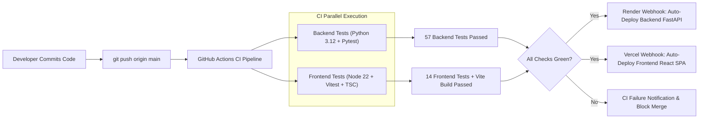

# System & User Workflows: WanderAI Travel Planner

This document provides a comprehensive operational guide detailing end-to-end user workflows, interactive lifecycle flows, and continuous integration/deployment (CI/CD) pipelines.

---

## 1. User Journey & Feature Workflows



---

## 2. Detailed Operational Workflows

### 2.1 Destination Discovery Flow
1. **User Action**: The traveler visits `/discover`.
2. **Parameters**: The user selects a travel vibe (e.g., Cultural, Adventure, Relaxation, Foodie), maximum flight duration, budget range, and preferred season.
3. **API Request**: Frontend triggers `POST /api/v1/recommendations/destinations`.
4. **Execution**:
   - The backend checks for cached destination metadata.
   - If AI is active, Google Gemini ranks destinations according to match scores, highlighting signature sights and estimated cost ranges.
   - If offline or on failover, the `MockProvider` generates high-quality destination matches.
5. **Outcome**: The user clicks **"Plan Trip to This Destination"**, which redirects to `/wizard?destination=Kyoto&vibe=cultural`, pre-populating Step 1.

---

### 2.2 Itinerary Generation Flow
1. **Validation**: Step 1 to Step 4 input fields are checked via client-side validation (end date $\ge$ start date, traveler count 1–50, non-negative budget).
2. **Trip Creation**: `POST /api/v1/trips` creates a trip container record in Supabase (or in-memory store) returning `trip_id`.
3. **Generation Dispatch**: `POST /api/v1/trips/{trip_id}/generate` triggers the AI orchestration engine.
4. **LLM Synthesis**:
   - Constructs a structured system prompt requesting a day-by-day sequence of morning, afternoon, and evening activities with realistic operating hours, geo-coordinates, and duration estimates.
   - Enforces valid JSON format.
5. **Heuristic Route Optimization**:
   - Activities within each day are clustered and sorted geographically using the Haversine Nearest Neighbor TSP heuristic to minimize transit times and avoid zig-zagging.
6. **Persistence & Navigation**: The generated itinerary and activities are persisted, and the traveler is redirected to `/trips/{trip_id}`.

---

### 2.3 Single-Day AI Regeneration Flow
When a traveler dislikes a single day (e.g., "It's raining on Day 3, replace outdoor walking with indoor museums"):
1. The user navigates to Day 3 and clicks **"Regenerate Day"**.
2. They enter custom feedback ("Replace outdoor hikes with art galleries and coffee shops").
3. They optionally select specific activities to **preserve/lock** (e.g., a pre-booked dinner reservation).
4. `POST /api/v1/itineraries/{itinerary_id}/days/{day_id}/regenerate` runs:
   - Preserved activities are isolated.
   - The AI generates replacement slots for unlocked periods.
   - The updated day schedule is returned in isolation without modifying Day 1, Day 2, or subsequent days.

---

### 2.4 Conversational Refinement & Version History
1. The traveler opens the **"Refine with AI"** slide-out panel on `/trips/{id}`.
2. The traveler specifies natural-language adjustments (e.g., *"Make Days 2 and 4 more budget-friendly and add vegetarian ramen recommendations"*).
3. `POST /api/v1/itineraries/{trip_id}/refine` creates a **new itinerary version** (Version 2, Version 3, etc.), keeping previous versions intact.
4. The traveler can open **"Version History"** to preview snapshots of older versions and click **"Restore this Version"** if they prefer an earlier schedule.

---

### 2.5 Multi-Format Export Flow
1. The traveler clicks the **Export** menu on the trip header:
   - **PDF / Print**: Sends `format=pdf` to `/export`. The backend serves a clean, responsive print-ready HTML template with print-media CSS triggers for direct `window.print()` PDF generation.
   - **iCalendar (.ics)**: Downloads standard RFC 5545 `.ics` file containing exact start/end timestamps and location coordinates for Apple Calendar, Google Calendar, and Outlook.
   - **Markdown (.md)**: Downloads formatted markdown for Obsidian, Notion, or text editors.
   - **JSON (.json)**: Downloads raw structured itinerary data for data portability.

---

### 2.6 Public Sharing & Companion Collaboration
1. **Public Sharing Link**:
   - The owner clicks **"Share Trip"**.
   - The backend generates a 32-byte cryptographic token (`secrets.token_urlsafe(32)`), hashes it via SHA-256 for database storage, and returns the public link `/share/{token}`.
   - Anyone with the link can view the read-only itinerary without creating an account or logging in.
2. **Companion Collaboration**:
   - The owner invites a companion by email with role `editor` or `viewer`.
   - The collaborator appears in the trip's collaborator list, protected by Row Level Security (RLS) policies.

---

## 3. Developer & CI/CD Pipelines



### 3.1 Local Development Workflow
- **Backend**:
  ```bash
  cd backend
  python -m venv venv
  venv\Scripts\activate   # Windows (source venv/bin/activate on macOS/Linux)
  pip install -r requirements.txt
  uvicorn app.main:app --reload --port 8000
  ```
- **Frontend**:
  ```bash
  cd frontend
  npm install
  npm run dev            # Starts Vite dev server on http://localhost:5173
  ```

### 3.2 Automated Testing Pipeline
Every commit and pull request against `main` triggers `.github/workflows/ci.yml`:
- **Python Job**: Runs on Python 3.12, installs dependencies, validates linting, and executes 57 Pytest test cases covering FastAPI endpoints, TSP routing, AI mock failover, and share token security.
- **Node Job**: Runs on Node.js 22 LTS, verifies TypeScript types (`tsc --noEmit`), bundles the production app (`vite build`), and runs 14 Vitest unit tests covering auth state management, form validation, and UI component behavior.
